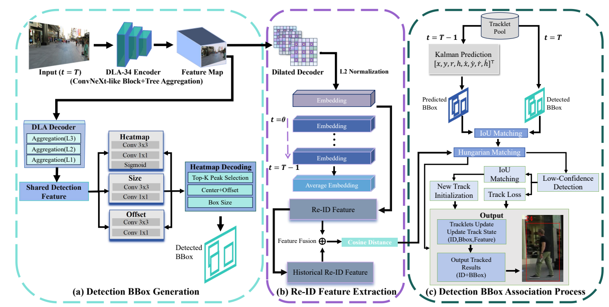
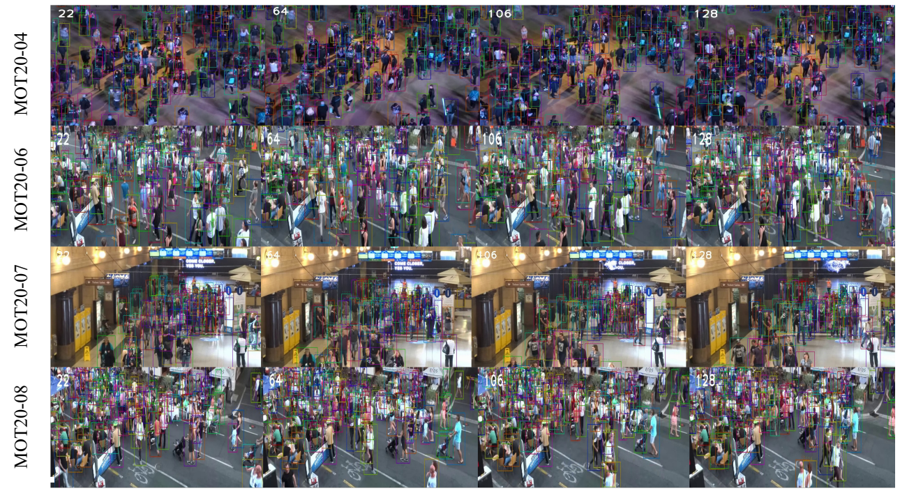

# DDTrack

## Towards Real-time Multi-object Tracking for Dense Scenes in Monitoring Scenarios

**Fenglei Xu, Suxin Chen, Bingwen Hu, Mingwu Ren, Ming Gao, Fa Zhu, Miguel Angel Díaz-Martínez, and David Camacho**

Accepted by **IEEE Transactions on Emerging Topics in Computational Intelligence (TETCI)**.

[Repository](https://github.com/chen123876/FairMOTVehicle) 

DDTrack (**Decoupled Dense-scene Tracking**) is a task-aware multi-object tracking framework for crowded monitoring scenarios. Built upon FairMOT, it strengthens contextual feature extraction and introduces a dedicated identity feature learning pathway to address severe occlusion, similar object appearances, and frequent identity switches. The paper evaluates DDTrack on MOT17, MOT20, and the proposed Tunnel-Vehicle MOT (TV-MOT) dataset.


## Method



DDTrack combines three components:

- **Contextual feature extraction:** a ConvNeXt-like redesign of DLA-34 enlarges the effective receptive field while retaining hierarchical feature aggregation.
- **Task-aware feature learning:** the detection branch uses the DLA decoder, while a dedicated Re-ID branch decodes high-level backbone features. Its lightweight dilated decoder uses dilation rates of **4, 8, 12, and 16** to capture contextual identity cues.
- **Online association:** motion prediction and appearance similarity support trajectory association using Kalman filtering and Hungarian matching.

The paper supervises object localization with heatmap and regression losses, and identity embeddings with a triplet loss with margin **0.3**.

## Results

All values in this section are **reported in the paper**, rather than measured from this checkout. MOTA, IDF1, and HOTA are percentages; IDSW counts identity switches.

### MOT20

| Method | MOTA ↑ | IDF1 ↑ | HOTA ↑ | IDSW ↓ |
| :---: | :---: | :---: | :---: | :---: |
| FairMOT | 61.8 | 67.3 | 54.6 | 5,243 |
| DDTrack | **63.2** | 64.4 | 51.9 | **2,634** |

DDTrack improves MOTA by **1.4 percentage points** and reduces identity switches by approximately **49.8%** relative to FairMOT. IDF1 and HOTA are lower in this comparison.

### TV-MOT

| Method | MOTA ↑ | IDF1 ↑ | HOTA ↑ | IDSW ↓ |
| :---: | :---: | :---: | :---: | :---: |
| FairMOT | 74.8 | 83.2 | 83.1 | **3** |
| DDTrack | **79.3** | **87.8** | **89.3** | 4 |


Timing uses one **Tesla V100**, FP32, batch size **1**, and input resolution **1088 × 608**. The first 20 frames of each of the four MOT20 test sequences are excluded as warm-up. The timed region includes host-to-device transfer, inference, detection decoding, Re-ID feature extraction, association, and track updating. Image loading, result writing, and visualization are excluded.



## Installation

Use a Linux environment with an NVIDIA GPU, a CUDA toolkit, and a C++ compiler for DCNv2. The legacy FairMOT documentation uses **Python 3.8, PyTorch 1.7.0, torchvision 0.8.0, and CUDA 10.2**. This is an upstream reference configuration; an exact DDTrack environment lockfile is not included.

```bash
conda create -n ddtrack python=3.8 -y
conda activate ddtrack
conda install pytorch==1.7.0 torchvision==0.8.0 cudatoolkit=10.2 -c pytorch

# Run from the repository root.
pip install cython
pip install -r requirements.txt
```

The current code uses the deprecated `np.float` alias, so it requires NumPy older than 1.24 unless those usages are updated. Dependencies in `requirements.txt` are unpinned; resolve their versions against the selected legacy Python/PyTorch environment.

Build the bundled deformable convolution extension:

```bash
cd src/lib/models/networks/DCNv2
bash make.sh
python -c "from dcn_v2 import DCN; print('DCNv2 import OK')"
cd ../../../../..
```

The bundled DCNv2 README targets an older PyTorch release. If it is incompatible with the chosen stack, consult the upstream [PyTorch 1.7 DCNv2 branch](https://github.com/ifzhang/DCNv2/tree/pytorch_1.7). Ensure `dcn_v2` is importable from the environment used for training.

## Data preparation

### Public datasets

Obtain datasets from their respective providers:

- [MOT17](https://motchallenge.net/data/MOT17/) and [MOT20](https://motchallenge.net/data/MOT20/).
- [CrowdHuman](https://www.crowdhuman.org/).
- MIX data preparation: see the [JDE dataset guide](https://github.com/Zhongdao/Towards-Realtime-MOT/blob/master/DATASET_ZOO.md). The paper uses MOT17, Caltech, CityPersons, CUHK-SYSU, ETH, and PRW in the MIX stage.

The training loader reads image path lists from a JSON configuration. Each image has a text label file with one object per line:

```text
class_id track_id x_center y_center width height
```

Bounding box coordinates are normalized by image width and height. Use class ID `0` for the single tracked category and consistent identity IDs within each sequence. Avoid reusing IDs for different objects within the same dataset list.

The active loader in `src/lib/datasets/jde.py` derives label paths by replacing `images` with `labels_with_ids` and the image extension with `.txt`. Prepare a matching layout, for example:

```text
/path/to/datasets/
└── MOT20/
    ├── images/train/MOT20-01/000001.jpg
    └── labels_with_ids/train/MOT20-01/000001.txt
```

An image list such as `/path/to/lists/mot20.train` contains paths relative to the configured dataset root:

```text
MOT20/images/train/MOT20-01/000001.jpg
MOT20/images/train/MOT20-01/000002.jpg
```

Edit `src/lib/cfg/data.json` for your machine:

```json
{
  "root": "/path/to/datasets",
  "train": {
    "mot20": "/path/to/lists/mot20.train"
  }
}
```

List filenames are resolved from the working directory; image paths in each list are joined to `root`. Absolute list paths avoid working-directory ambiguity. Legacy conversion scripts are provided under `src/gen_labels_*.py`; inspect their input paths before use.

### TV-MOT

**TV-MOT (Tunnel-Vehicle Multi-Object Tracking)** is a self-constructed vehicle tracking dataset developed for tunnel traffic monitoring. The source videos were collected from a tunnel in **Shanghai, China**, and converted into image sequences to form the dataset. Frame order is preserved so that vehicles can be tracked across consecutive images. The dataset covers both tunnel-interior and tunnel-exterior scenes.

TV-MOT complements public pedestrian tracking benchmarks by providing tunnel-specific vehicle imagery. Its main challenges include:

- **Reflections and illumination changes:** vehicle headlights and reflections on tunnel walls can resemble objects and cause false detections, while changing lighting conditions affect vehicle appearance.
- **Dense traffic and occlusion:** closely spaced vehicles frequently overlap, making it difficult to maintain consistent identities across frames.
- **Small targets and perspective compression:** distant vehicles occupy only a small image region, and perspective reduces the apparent spacing between them.
- **Background interference:** roadside structures and other background content complicate vehicle detection and association, particularly outside the tunnel.

The paper lists the following training sequences:

| Sequence | FPS | Resolution | Frames | Vehicles | Scene |
| :---: | :---: | :---: | :---: | :---: | :---: |
| 0 | 30 | 1280 × 720 | 612 | 15 | Inside tunnel |
| 1 | 30 | 1280 × 720 | 646 | 18 | Inside tunnel |
| 2 | 30 | 1280 × 720 | 536 | 16 | Inside tunnel |
| 7 | 30 | 1280 × 720 | 214 | 31 | Outside tunnel |

Training annotations contain class IDs, object IDs, and normalized bounding boxes. Test annotations additionally support MOT Challenge evaluation. This checkout contains local directories named `TVMOT/` and `dataset/SubwayCar.v1/`; their names alone do not establish the full paper split. A separate public dataset download URL is not specified here.

For local sequence evaluation, the expected structure is:

```text
test/
└── sequence_name/
    ├── img1/
    ├── gt/gt.txt
    └── seqinfo.ini
```

## Training


### Current training interface

After resolving the [implementation prerequisites](#implementation-status) and preparing the configuration, the existing entry point accepts the following command from the repository root:

```bash
python src/train.py mot \
  --exp_id mot20_experiment \
  --arch dla_34 \
  --gpus 0 \
  --batch_size 12 \
  --num_epochs 30 \
  --lr 1e-4 \
  --lr_step 20 \
  --data_cfg src/lib/cfg/data.json
```

This illustrates the current interface, rather than the complete paper reproduction pipeline. Checkpoints and logs are written under `exp/mot/mot20_experiment/`. To resume an experiment, use the same `--exp_id` with `--resume`. Use `--load_model /path/to/checkpoint.pth` to supply weights; inspect the checkpoint epoch before stage transitions because the current loader returns the stored epoch even without `--resume`.

No verified download link for a trained DDTrack checkpoint is included here. Upstream FairMOT weights correspond to the baseline and do not establish DDTrack performance.

## Evaluation

### MOT20 sequences with ground truth

After resolving the implementation prerequisites, run from the repository root:

```bash
python src/track.py mot \
  --gpus 0 \
  --arch dla_34 \
  --val_mot20 True \
  --data_dir /path/to/datasets \
  --load_model /path/to/checkpoint.pth \
  --conf_thres 0.3
```

This expects `MOT20/train/<sequence>/img1`, `seqinfo.ini`, and `gt/gt.txt` under the supplied data directory. The script writes tracking files and an Excel metrics summary under `MOT20/results/mot20_val/`.

The current `track.py` entry point selects MOT20 sequences only. Although legacy MOT17 options remain in the argument parser, MOT17 sequence selection must be restored before evaluating MOT17. The script also evaluates ground truth unconditionally, so MOT20 test-set result export needs a path that skips local ground-truth evaluation. Official test-set scores require submission to [MOTChallenge](https://motchallenge.net/).

### Vehicle sequences

`src/track_subwaycar.py` provides a local vehicle evaluation workflow. Before running it, update `data_root`, `seqs`, and `opt.load_model` in its main block. The hard-coded checkpoint assignment currently overrides `--load_model`.

The included evaluator uses `motmetrics` for standard MOT metrics. Use [TrackEval](https://github.com/JonathonLuiten/TrackEval) to compute HOTA with the matching dataset protocol; HOTA is not computed by the included evaluator. The vehicle script currently writes 11 result columns, so convert its output to the format expected by the target tool before external evaluation.

### Runtime benchmark

`src/benchmark_runtime.py` follows the paper's timing boundaries and excludes 20 warm-up frames per sequence:

```bash
python src/benchmark_runtime.py mot \
  --gpus 0 \
  --arch dla_34 \
  --data_dir /path/to/datasets \
  --load_model /path/to/checkpoint.pth \
  --conf_thres 0.3
```

It processes MOT20-04, MOT20-06, MOT20-07, and MOT20-08 from `MOT20/test/` and reports latency and FPS. It requires one CUDA GPU. Compare models under the same hardware, precision, resolution, and timing protocol.


## Citation

If this work is useful in your research, please cite the paper. The entry below records acceptance; add the official publication year, DOI, volume, issue, and pages when available.

```bibtex
@article{xu_ddtrack,
  title   = {Towards Real-time Multi-object Tracking for Dense Scenes in Monitoring Scenarios},
  author  = {Xu, Fenglei and Chen, Suxin and Hu, Bingwen and Ren, Mingwu and Gao, Ming and Zhu, Fa and D{\'i}az-Mart{\'i}nez, Miguel Angel and Camacho, David},
  journal = {IEEE Transactions on Emerging Topics in Computational Intelligence},
  note    = {Accepted for publication}
}
```


## License

The repository includes an [MIT License](LICENSE) retaining the upstream FairMOT copyright notice. Dataset access and use are subject to the respective dataset providers' terms.
